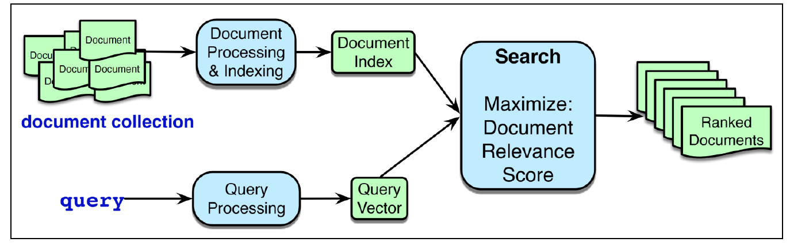

## Before starting

"Class" 카테고리에 있는 포스팅들은 실제로 수업에서 배운 내용을 정리하려는 목적으로 작성되었다. 이 글은 그 중 Text Mining 과목의 수업을 다룬다.

## Ad-hoc Search

Classification 다음으로 알아볼 작업은 Search다. Search는 우리가 원하는 데이터를 얻을 수 있는 가장 기본적인 과정이다. 그런데 이 Search도 사실 여러 가지 세부 Task들이 존재한다. Search에서 있을 수 있는 시나리오들이 다양하기 때문인데, 그 중에서 이 글에서 다룰 것은 Ad-hoc Search이다. 

Ad-hoc Search는 사용자가 직접 질문을 입력하는 시나리오를 의미한다. 즉, 이 Task에서는 Query가 자연어의 형태로 주어지며, 그 Qeury와 가장 연관되어 있는 Document를 정렬하여 사용자에게 보여주는 것을 목표로 한다.

여기서 Document는 어떠한 Text Unit도 가능하며, 이러한 Document의 집합을 Collection이라고 부른다. 그리고 이 Ad-hoc Search를 수행하기 위해 구성하는 자료구조를 Index라고 부른다.

그리고 이러한 Ad-hoc Search를 수행하기 위해 주어진 Query와 각각의 Document가 얼마나 관련이 있는지를 점수로 매겨야 하는데, 이를 Relevance Score라고 부른다. 당연히 이 Relevance Score가 높을수록 더 연관이 있다는 의미가 된다. 이 "Relevance"를 계산하는 방법은 다양하지만, 가장 간단한 예시로는 Query와 Document들을 전부 Vector로 만들고, 이들 Vector 간의 유사도를 사용하는 방법이 있을 것이다.

## Evaluation Metrics

그러면 가장 관련 있는 $N$개의 Document를 리턴했을 때, 이것이 얼마나 잘 된 검색인지 어떻게 평가할 수 있을까? 여기서도 [Classification](https://blog.cloudholic.dev/posts/tm-4/#evaluation)에서도 다루었던 Precision과 Recall의 개념을 그대로 활용할 수 있다. 

### NDCG@N

## Lexical Retrieval

### TF-IDF

### Inverted Index

### BM25
