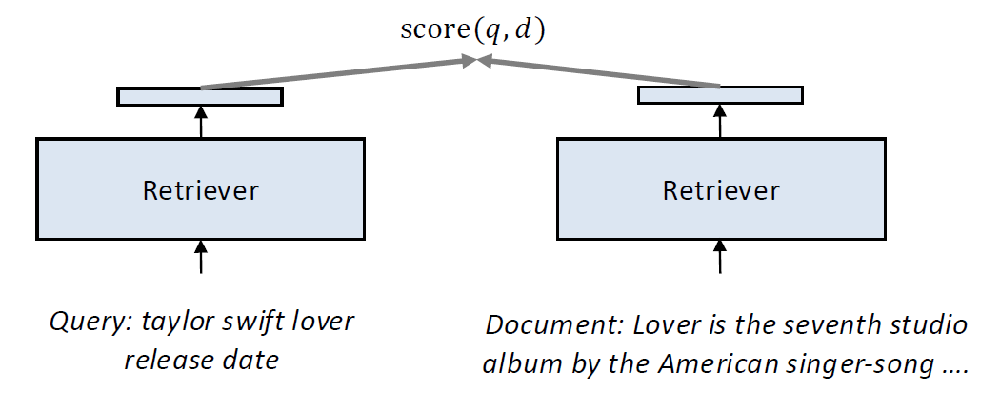
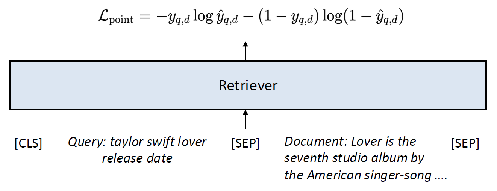
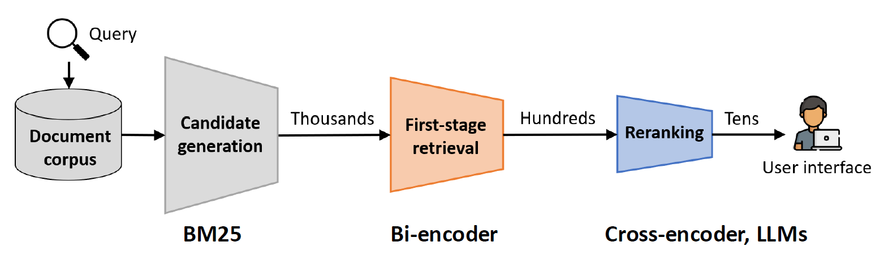
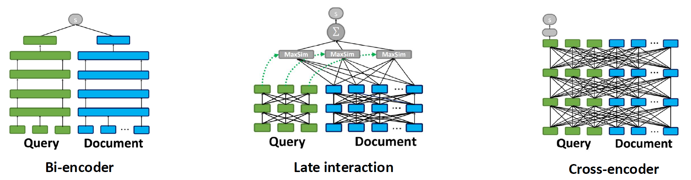
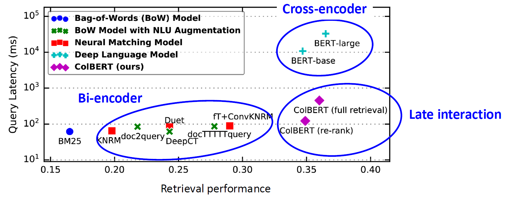
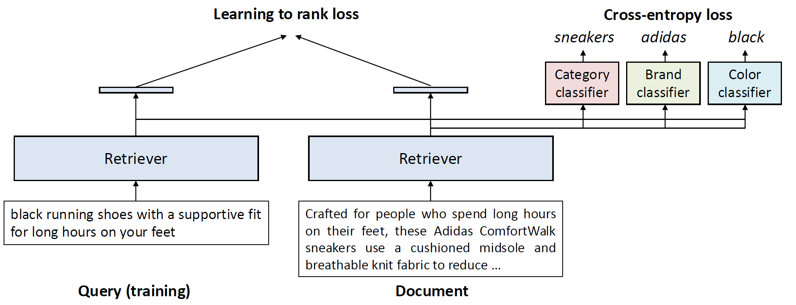

## Before starting

"Class" 카테고리에 있는 포스팅들은 실제로 수업에서 배운 내용을 정리하려는 목적으로 작성되었다. 이 글은 그 중 Text Mining 과목의 수업을 다룬다.

## Graded Relevance List-wise

[저번 글](https://blog.cloudholic.dev/posts/tm-9/)에서 다뤘던 List-wise Learning은 Binary상황을 가정한다. 그런데 저번 글에서 알아봤듯이, Relevance는 Binary로만 정의되지는 않고, Negative Document들도 그들 사이에서 상대적인 Relevance를 가질 수 있다. 그래서 이러한 점까지 살려서 학습시키기 위한 방법이 Graded Relevance List-wise Learning이다.

이러한 경우에는 주어진 Query와 $N$개의 Document들에 대해, 상대적인 순서 $\pi^{\ast}$를 맞추게 해야 한다. 
우선 특정한 Permutation $\pi$가 발생할 확률은 다음과 같이 정의할 수 있다. 여기서 $\pi_i$는 Permuatation $\pi$에서 $i$번째로 등장하는 Item을 의미한다.

$$P(\pi\vert q)=\prod_{i=1}^{N}\dfrac{\exp(\text{score}(q,d_{\pi_i}))}{\sum_{k=i}^{N}\exp(\text{score}(q,d_{\pi_k}))}$$

따라서, 위의 확률을 최대화하는 방향으로 학습시키면 우리가 원하는 결과를 얻게 되고, 이를 위해 Negative Log를 취하면 다음과 같은 Loss Function을 얻을 수 있다.

$$\mathcal{L}_{\text{list}}=-\log P(\pi^{\ast}\vert q)=-\sum_{i=1}^{N}\dfrac{\exp(\text{score}(q,d_{\pi^{\ast}_i}))}{\sum_{k=i}^{N}\exp(\text{score}(q,d_{\pi^{\ast}_k}))}$$

이러한 방식의 모델을 **Plackett-Luce Model**이라고 한다. 또한 이 함수와 같이 모든 순서를 다 계산할 수도 있지만, 상위 $N$개에 대해서만 계산하고 나머지는 Marglinzation하여 간소화시킨 버전으로도 사용하기도 한다.

그러나 현실에서는 모든 Document에 대한 상대적인 순서까지 라벨링하는 경우는 거의 없다. 따라서, 이러한 방식은 LLM을 사용해 우선 Ranking 순서를 얻은 후, 이를 기반으로 하여 보다 단순한 검색 모델을 학습시키는 식, 즉 Knowledge Distillation으로 주로 활용된다.

## Bi-encoder

지금까지 알아본 Dense Retrieval들은 전부 Query와 Document를 별개의 Retriever에 의해 각각 Vector로 표현하고, 이들의 Inner Product를 통해 Relevance Score를 구하는 방식을 취했다. 

이런 식으로 Query와 Document를 독립적으로 Encoding하는 방식을 Bi-encoder라고 부른다.

그러나 이러한 Bi-encoder 방식은 Query에 상관없이 Document Vector가 항상 동일하다는 단점이 존재한다. Document에서 중요한 부분은 Query에 따라 달라질 수 있는데 Bi-encoder는 이 점을 전혀 고려할 수 없다. 즉, Query-Specific Information을 캐치하기 어렵다.

## Cross-encoder

이러한 단점을 해결하기 위한 가장 직관적인 방법이 Cross-encoder이다. 결국 Bi-encoder의 단점은 Query와 Document를 독립적으로 Encoding한다는 점에서 기인하기 때문에, 이를 근본적으로 해결하기 위해서는 이들을 Concat해서 하나의 Input으로 넣어줘야 한다는 발상이다.

위 그림과 같이 Input 방식만 바뀌었을 뿐이고, Retriever는 여태 알아본 그것을 그대로 사용한다.

이렇게 구성된 Cross-encoder는 Bi-encoder보다 웬만하면 성능이 좋게 나온다. Query와 Document를 동시에 보면서 Encoding을 하기 때문에 Self-Attention을 적극적으로 활용하기 떄문이다. 그리고 Document의 어떤 Term이 중요한지를 명확하게 알 수 있으므로 매우 세밀한 Fine-grained interaction이 가능하다.

그러나 Cross-encoder 역시 만능의 방법은 아닌데, 대표적으로 비용이 너무 비싸다. Bi-encoder는 Document를 따로 Encoding하면서 ANN Index 등 시간적으로 효율적인 자료구조를 활용할 수 있다. 즉 Document에 대해서만 미리 Pre-indexing이 가능하다. 그러나 Cross-encoder는 Query와 동시에 Encoding을 해야 하므로 이런 식의 테크닉을 활용할 수 없다. 이로 인해 Scale이 커지면 Cross-encoder 자체를 활용하기 어렵다.

이러한 뚜렷한 장단점으로 인해, 현대의 검색 엔진은 단일 모델을 사용하기보다는 아래와 같은 Multi-stage pipeline을 취한다.

먼저 방대한 Corpus에서 BM25를 적용해서 매우 빠르게 Data를 추려 Candidate를 구성한다. 그리고 여기서 Bi-encoder를 적용해서 1차 검색을 수행한다. 여기서 얻은 결과만을 대상으로 Cross-encoder를 수행하여, 최종적으로 유저에게 보여지는 극소수의 Document들만 얻어내는 방식을 취한다. 

이러한 단계들을 각각 Candidate Generation, First-stage Retrieval, 그리고 Reranking이라고 부른다.

## Late Interaction

Cross-encoder는 Bi-encoder보다 성능이 좋다는 데엔 이견이 없지만, 역시 너무 비싼 시스템이라는 점이 문제가 된다. 그래서 Bi-encoder를 어떻게든 개선하려는 연구가 진행되었고, 그 중 하나가 Late Interaction이다.

Late Interaction의 핵심 아이디어는 Bi-encoder와 Cross-encoder의 접근 사이에서 균형을 잡아보자는 것이다. 즉, Bi-encoder의 장점을 유지시킬 수 있도록 $L$개 Document와 $M$개의 Query를 독립적으로 Encoding시켜 $e_{d_1},e_{d_2},\cdots,e_{d_L}$, $e_{q_1},e_{q_2},\cdots,e_{q_M}$을 얻는 것은 Bi-encoder와 동일하지만, Relevance Score를 다음과 같이 다르게 구한다.

$$\text{score}(q,d)=\sum_{m=1}^{M}\max_{1\le l\le L}(e_{q_m}^Te_{d_l})$$

Relevance Score를 이렇게 계산하면 각각의 Query Token에 대해 가장 근접한 Document Token을 찾을 수 있다. 그리고 그들을 합해서 최종 점수로 삼는 것이다. 즉, 마치 Cross-Attention 연산을 간소화시킨 것과 유사한 방식이 된다.

그러면 Late Interaction에서 Indexing은 어떻게 할 수 있을까? 위의 Relevance Score 계산식에서도 알 수 있듯이, 모든 Document에 대한 Token Vector를 전부 저장해야만 한다. 그래서 Indexing에 필요한 공간 자체는 크게 늘어나게 된다. 

그래도 이들 벡터는 Dense Context Vector이므로, ANN Index를 활용할 수 있다. 단지 그것이 Document level이 아니라 Token level에서 이루어질 뿐이다. 그래서 Bi-encoder보다는 Indexing에 불리하게 된다. 그러나 어쨌든 Indexing이 가능하기 떄문에 Indexing 자체가 불가능한 Cross-encoder보다는 훨씬 빠르게 된다. 

이런 방식으로 구성된 Late Interaction은 위 사진과 같이 성능이 상당히 준수하게 나온다. 다만 이 결과는 Fine-tuning이 된 상태인 것이고, 재밌게도 Fine-tuning이 되지 않은 상태로 비교했을 때는 Bi-encoder는 BM25보다도 성능이 낮게 나온다. 

이는 Bi-encoder는 모든 정보를 모든 정보를 하나의 Vector로 뭉쳐서 표현하므로 안 그래도 정보 손실이 일어나는데다가, Target corpus에 대해 직접적으로 학습할 기회조차 없었기 때문이다. 다만 Late Interaction과 Cross-encoder는 각 Token 간의 연관성을 판단하기 떄문에 Fine-tuning 없이도 생각보다 좋은 결과가 나온다.

## Infusing User-Intersted Aspects

이번엔 Bi-encoder를 개선하는 또 다른 방법을 알아보자. 

Bi-encoder는 모든 Text를 하나의 Vector로 표현하기 때문에 그 과정에서 세밀한 정보를 잃어버리게 되고, Late Interaction은 이를 Token level에서 수행해서 완화할 수 있었으나 Indexing cost가 늘어난다.

그래서 결국 유저가 관심 있어 하는 측면을 더 잘 드러내도록 Embedding 접근을 좀 바꿔보려는 연구가 있었다. 즉, 검색 엔진의 Provider는 사실 User가 뭘 알고 싶어 하는지를 이미 알고 있는 경우가 많으며, 그런 측면이 잘 드러나게끔 하면 정보 손실이 적지 않겠냐는 발상이다.

사실 이러한 접근은 먼저 User-interested aspects가 어떻게 발견하고 해당하는 값을 어떻게 추출할지에 대한 연구가 선행되어야 한다. 이쪽은 Information Extraction이라는 Topic으로 연구가 되고 있으며, 과거에는 Rule-based Tool을 사용했다가 최근에는 LLM을 활용하는 방향으로 발전되고 있다고 한다. 
그러나 이쪽에 대한 연구는 이 시리즈의 범위를 넘으므로 일단 User-intersted aspect 및 그에 대한 정보는 이미 주어져 있다고 가정하자.

이 상황에서 문제를 정의하면 다음과 같다. 

$N$개의 Document로 이루어진 Corpus $D=\lbrace d_1,d_2,\cdots,d_N\rbrace$와 미리 정의된 Aspect 타입의 집합 $\mathcal{A}$가 주어졌다. 즉, 사용자가 이미 어느 측면에 대해 궁금해하는지를 이미 알고 있다. 
또한, 각각의 $a\in\mathcal{A}$에 대해서 고정된 Vocabulary의 집합 $\mathcal{V}_a=\lbrace v_1^{(a)},v_2^{(a)},\cdots,v_{\vert V_a\vert}^{(a)}\rbrace$가 주어져 있다. 즉, 해당 Aspect $a$에 해당하는 단어들까지 이미 주어져 있는 셈인데, 사실 이 정보들은 Corpus를 잘 Mining하면 얻을 수 있는 정보이기 떄문에 그렇게까지 비현실적인 가정은 아니다.
마지막으로 각각의 Document $d_i$는 Raw Text $x_i$와 사전에 잘 정리해놓은 Aspect Annotations $y_i=\lbrace y_i^{(a)}\vert a\in\mathcal{A}\rbrace$, $y_i^{(a)}\in\mathcal{V}_a$로 이루어져 있다. 즉, 어떠한 Aspect를 사용자가 궁금해할 것이고, 이러한 값들을 이 Document에서 다루고 있다는 정보를 Label로써 갖고 있다.

문제에서 정의하는 데이터들이 꽤 많은데, 요약하면 Document에서 중요한 Aspect들을 정리해놓은 Dictionary가 추가로 제공된 상태로 이해하면 된다. 그러면 이 추가적인 정보를 어떻게 Bi-encoder를 개선하는 데에 활용할 수 있을까?

가장 간단한 방법으로는 이 추가적인 정보들을 Original Text에 Concat해서 추가적인 Context로 사용해볼 수 있다. 이러면 확실히 Document Vector에 User-intersted aspect가 반영되기는 한다. 그러나 이러한 접근은 Query에는 적용될 수 없다는 문제가 남는다. Query는 Serving Time에 주어지게 되므로, 이걸 실시간으로 추론하는 것은 비용적으로 굉장히 손해이다.

그래서 위와 같은 Naive한 접근 말고 다른 방식이 필요하다. 

Aspect 정보를 Document에 대해서는 갖고 있지만, Query에 대해서는 사전에 넣어줄 방법이 존재하지 않기 떄문에 이러한 Aspect 정보를 추론하는 능력을 학습시켜서 Retriever에 명시적으로 상속시켜야 한다. 그런데 이 방법은 결국 Unseen Text에 대해서, 각각의 Aspect Class에 대해 어느 값에 해당하는지를 추론하는 작업이 되는데, 이건 곧 Classification Task다. 즉, Classification을 검색에 적용해볼 수 있다.

이러한 아이디어를 바탕으로 한 Multi-task Learning은 위와 같은 형태가 된다. 그리고 Loss 역시 둘을 합한 아래의 Loss를 사용하게 된다.

$$\mathcal{L}_{\text{rank}}+\lambda\sum_{a\in\mathcal{A}}\mathcal{L}_{\text{CE}}^{(a)}$$

즉, Retriever는 기존의 Learning to rank에 더해 Aspect를 식별하는 능력을 배우게 된다. 이러면 Serving Time에 추가되는 Query에 대해서도 가장 연관 있는 Aspect를 식별할 수 있는 능력이 생기며, 이를 Vector에 반영할 수 있게 된다. 

심지어 이러한 접근은 Late Interaction마냥 Token level의 정보를 저장할 것을 요구하지도 않는다. 이는 애초에 Document Vector에 User-interested Aspect가 반영되게끔 학습된 상태이기 떄문이다. 따라서 Bi-encoder의 ANN Index를 그대로 활용할 수 있으며, 이로 인해 Indexing 비용이 Bi-encoder와 동일하다는 장점이 있다.
