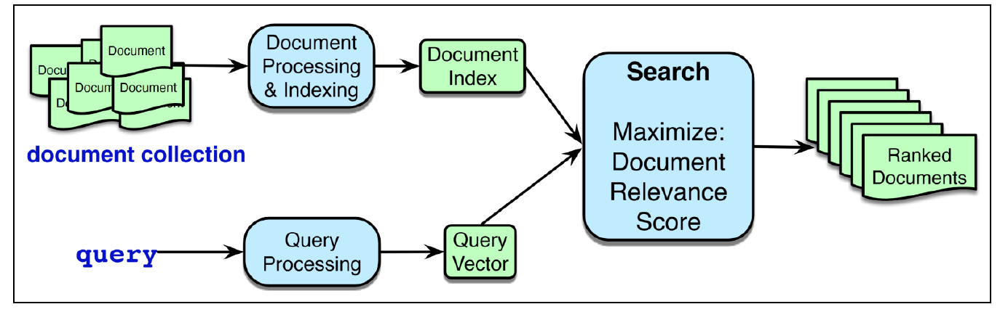
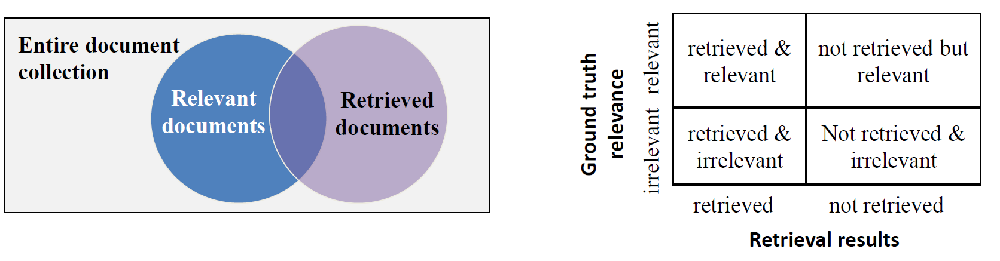
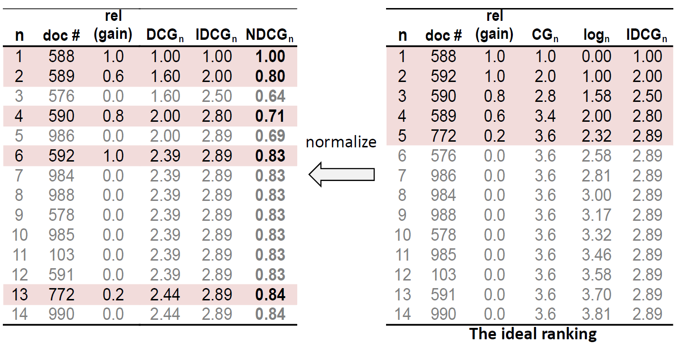
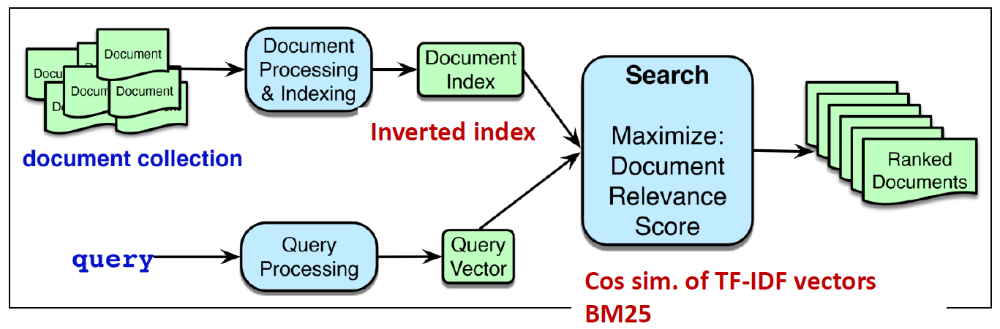
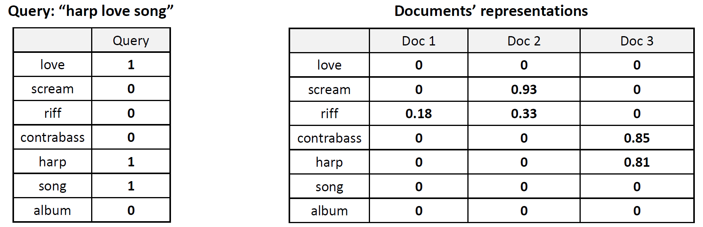
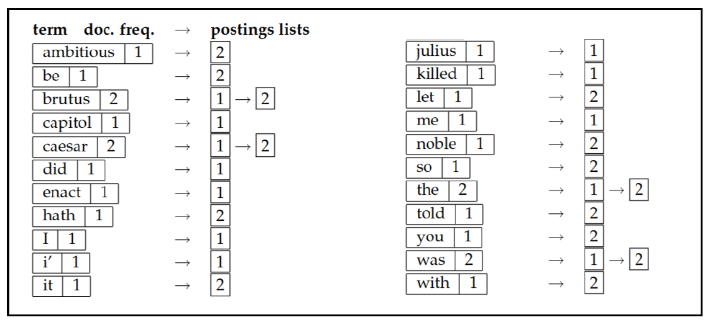
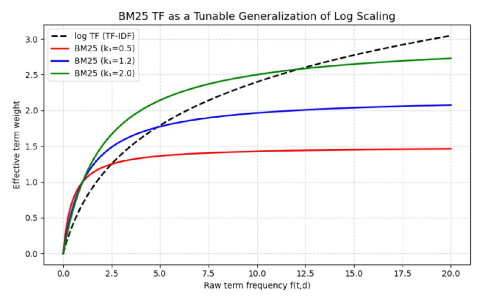

## Before starting

"Class" 카테고리에 있는 포스팅들은 실제로 수업에서 배운 내용을 정리하려는 목적으로 작성되었다. 이 글은 그 중 Text Mining 과목의 수업을 다룬다.

## Search

Classification 다음으로 알아볼 작업은 Search다. Search는 우리가 원하는 데이터를 얻을 수 있는 가장 기본적인 과정이다. 데이터를 기본적으로 벡터로 표현하므로, 두 벡터가 얼마나 유사한지를 판단하는 것이 Search의 핵심이라고 볼 수 있다. 
그런데 이 시리즈의 [첫 토픽](https://blog.cloudholic.dev/posts/tm-1/#representing-texts-with-vectors)에서 다루었듯이, 텍스트를 벡터로 표현하는 방법에는 여러 가지가 존재한다. 이에 따라 Search 역시 여러 방법이 존재하는데, 크게 다음과 같이 나눌 수 있다.

- **Lexical Retrieval**은 Query와 Document를 Sparse Vector로 표현하고, Exact word matching에 초점을 맞춰 각 Sparse Vector 간의 유사도를 계산하는 기술이다.
- **Dense Retrieval**은 BERT를 비롯한 Dense Embedding으로 표현된 Vector를 활용하여, Semantic Similarity에 초점을 맞춰 검색을 수행하는 기술이다.
- **LLM-Enhanced Retrieval**은 LLM을 통해 검색 결과를 개선하는 기술이다.

또한 Search에도 여러 가지 세부 Task들이 존재한다. Search에서 있을 수 있는 시나리오들이 다양하기 때문인데, 그 중에서 이 글에서 다룰 것은 Ad-hoc Search이다.

### Ad-hoc Search

Ad-hoc Search는 사용자가 직접 질문을 입력하는 시나리오를 의미한다. 즉, 이 Task에서는 Query가 자연어의 형태로 주어지며, 그 Query와 가장 연관되어 있는 Document를 정렬하여 사용자에게 보여주는 것을 목표로 한다.

여기서 Document는 어떠한 Text Unit도 가능하며, 이러한 Document의 집합을 Collection이라고 부른다. 그리고 이 Ad-hoc Search를 수행하기 위해 구성하는 자료구조를 Index라고 부른다.

그리고 이러한 Ad-hoc Search를 수행하기 위해 주어진 Query와 각각의 Document가 얼마나 관련이 있는지를 점수로 매겨야 하는데, 이를 Relevance Score라고 부른다. 당연히 이 Relevance Score가 높을수록 더 연관이 있다는 의미가 된다. 이 "Relevance"를 계산하는 방법은 다양하지만, 가장 간단한 예시로는 Query와 Document들을 전부 Vector로 만들고, 이들 Vector 간의 유사도를 사용하는 방법이 있을 것이다.

## Evaluation Metrics

그러면 가장 관련 있는 $N$개의 Document를 리턴했을 때, 이것이 얼마나 잘 된 검색인지 어떻게 평가할 수 있을까? 우선 [Classification](https://blog.cloudholic.dev/posts/tm-4/#evaluation)에서 다루었던 Precision과 Recall의 개념을 그대로 활용할 수 있다. 

즉, 위 사진과 같은 Confusion Matrix를 구성할 수 있다.

여기서 Retrieved Documents는 사용자의 Query에 대해 검색 시스템이 리턴한 Document들을, Relevant Documents는 실제로 관련 있는 Document들을 의미한다. 이를 바탕으로 Precision과 Recall을 계산할 수 있다.

$$\text{Precision@N}=\dfrac{\text{Number of relevant documents in top N}}{N}$$

$$\text{Recall@N}=\dfrac{\text{Number of relevant documents in top N}}{\text{Total number of relevant documents}}$$

여기서 $N$은 검색 결과로 리턴한 Document의 개수를 의미한다. 상위 $N$개까지만 보기 때문에 이들 지표를 각각 Precision@N, Recall@N이라고 부른다.

### NDCG@N

그런데 위의 지표들은 단순히 관련이 있는지 없는지만을 고려하기 때문에, 실제 상황을 제대로 반영하진 못한다. 연관성은 이렇게 Binary하게 구분되지 않고, 실제로는 관련성에 따라 Grade가 존재하는 개념이라 이를 고려한 평가가 필요하다. 예컨대 E-Commerce에서 사용되는 ESCI Dataset에서는 다음과 같이 4개의 Grade를 정의하고 있다.

- Exact(Highly relevant): 1.0
- Substitute(Somewhat relevant): 0.8
- Complement(Weakly relevant): 0.2
- Irrelevant(Not relevant): 0.0

이러한 경우에는 당연히 더 연관성이 있는 Document가 더 상위에 위치했는지를 평가해야 한다.

이를 반영한 가장 간단한 지표에는 **Cumulative Gain (CG)**이 있다.

$$\text{CG}_n=\sum_{i=1}^{n}\text{rel}_i$$

$\text{CG}_n$은 위와 같이 상위 $n$개의 Relevance Score를 전부 더한 누적합이다. 그런데 일반적으로 검색 결과에서는 상위권에 위치한 결과가 더 중요하기 때문에, CG같이 단순한 누적합보다는 순위에 따른 가중치를 부여하는 것이 좀 더 자연스럽다. 이를 **Discounted Cumulative Gain (DCG)**라고 한다.

$$\text{DCG}_n=\text{rel}_1+\sum_{i=2}^{n}\dfrac{\text{rel}_i}{\log_2 i}$$

이 순위에 따른 Penalty를 부여하는 방법엔 여러 가지가 있겠지만, 일반적으로 위와 같이 $\log_2$로 나누는 방법을 많이 사용한다. 

이 DCG는 꽤 합리적인 지표지만, 아직 문제가 하나 더 있다. 바로 Query마다 관련 있는 Document의 개수는 당연히 다르고, 이에 따라 DCG의 최댓값 역시 Query에 의해 달라질 수 있다는 점이다. 따라서 DCG만으로는 이것이 얼마나 좋은 결과인지 확인하기 어렵다.

따라서 서로 다른 Query끼리 공평하게 비교하기 위해 이를 정규화해야 한다. 이를 **Normalized Discounted Cumulative Gain (NDCG)**라고 한다.

$$\text{NDCG}_n=\dfrac{\text{DCG}_n}{\text{IDCG}_n}$$

DCG를 정규화하기 위해선 **Ideal Discounted Cumulative Gain (IDCG)**를 계산해야 한다. IDCG는 이 Query에 대한 이론상 가능한 DCG의 최댓값이다. 이를 통해 NDCG는 항상 최댓값이 1이 된다.

## Lexical Retrieval

이제 Lexical Retrieval에 대해 알아보자. 위에서 잠깐 언급했듯이, Lexical Retrieval은 Query와 Document를 Sparse Vector로 표현하고, 그 위에서의 유사도 계산을 수행하는 방법이다. 그렇기 때문에 예전에 다뤘던 [Sparse Representation](https://blog.cloudholic.dev/posts/tm-1/)에 대한 내용을 알고 있어야 한다.

전체적인 흐름은 위 그림과 같다.

### TF-IDF

각각의 Sparse Vector에 대해 TF-IDF가 수행되었다고 가정하자. 여기서 Query와 Document 간의 Relevance Score를 계산하기 위한 방법으로 Cosine similarity를 사용할 수 있지만, 보다 간략화하기 위해 다음과 같이 정의하자.

$$\text{Score}(q,d)=\sum_{t\in q}\text{tfidf}_{t,d}$$

즉, Query Vector는 어차피 IDF가 생략되어 TF만 존재하므로 Query Vector에 대한 Normalization을 생략해도 무방하다는 논리이다.

또한 계산량을 줄이기 위해 이렇게 간략화된 Score를 사용하더라도, 아직 좀 더 효율적으로 계산할 수 있는 방법이 존재한다.

위의 예시 상황과 같이, 사실 모든 Document에 대한 Relevance Score를 계산할 필요는 없다. Document 1과 2는 애초에 Query에 등장한 단어가 하나도 없어서 Relevance Score를 계산해봤자 0이기 때문이다.

### Inverted Index

그래서 이와 같이 어차피 계산할 필요가 없는 Document들을 효율적으로 제외할 방법을 생각하게 된다. 이를 만족하는 Data Structure를 Inverted Index라고 한다.

Inverted Index의 기본적인 원리는 각각의 Term에 대해서 이 Term을 포함하는 Document가 무엇인지 미리 찾아서 저장하는 것이다.

그래서 위 사진과 같이, 각각의 Term이 저장된 Dictionary(or Vocabulary)와 이 Term을 포함하고 있는 Document ID를 저장한 Posting List로 구성된다. Inverted Index를 구성하는 방법도 직관적인데, 모든 Term-Document Pair를 수집한 후 그대로 넣어주면 된다. 그 과정에서 Document Frequency, Term Frequency 등을 저장하면 추후 검색에 사용될 때 좀 더 효율적으로 활용할 수 있다.

Inverted Index의 목적은 관련 없는 Document를 제외하는 것에 있다. 그런데 Inverted Index는 Term 단위로 사전에 계산을 해놓는 자료구조이고, 하나의 Query가 여러 개의 Term으로 구성될 수 있기 때문에 일부의 Term만 포함하는 Document도 존재할 수 있다. 

예전에는 이런 경우에 교집합을 사용해서, 모든 Term을 포함한 Document만을 대상으로 Relevance Score를 계산했었으나, 최근에는 합집합을 사용하여 Query에 포함된 Term 중 일부만 포함해도 Candidate로 간주하여 Relevance Score를 계산하는 편이다.

### BM25

BM25 (Best Match 25th)는 1995년에 발표된 Lexical Retrieval 기반의 Ranking Function인데, 발표된 지 아주 오래되었지만 현대 검색 시스템에도 여전히 널리 사용되고 있다.

BM25는 TF-IDF를 기반으로 하여 개선시킨 함수이다. 구체적으로 다음과 같이 정의된다.

$$\text{BM}25(q,d)=\sum_{t\in q}\log\left(\dfrac{N-n(t)+0.5}{n(t)+0.5}+1\right)\cdot\dfrac{f(t,d)\cdot(k_1+1)}{f(t,d)+k_1(1-b+b\cdot\dfrac{\vert d\vert}{\text{avgdl}})}$$

여기서 각각의 함수 및 표현은 다음과 같다.

- $N$: 전체 Document의 개수
- $n(t)$: Term $t$를 포함하는 Document의 개수(즉, Document Frequency)
- $f(t,d)$: Document $d$에서 Term $t$의 등장 횟수(즉, Term Frequency)
- $\vert d\vert$: Document $d$의 Term 개수(즉, Length)
- avgdl: Document Length의 평균

BM25 함수에서 앞의 항은 IDF를, 뒤의 항은 TF를 대체하기 위한 항이라고 생각할 수 있다. 이제 각 항을 자세히 살펴보자.

먼저 IDF부터 확인해보자. 원래의 IDF는 다음과 같다.

$$\text{IDF}(t)=\log\left(\dfrac{N}{n(t)}\right)$$

즉, Document Frequency가 높을수록 흔한 Term이므로 중요도를 낮추기 위한 항이다. 그런데 이 식에는 문제가 있는데, 희귀한 Term을 너무 Boosting하고 빈번한 텀을 너무 억제하는 경향이 있다는 것이다. 즉, 값이 너무 극단적으로 계산된다.

예컨대 모든 Document에 다 등장하는 Term이라고 해도 그것의 정보량이 0이 되는 것은 아닐 수 있는데, 그 점이 IDF에는 반영되지 않고 계산 결과가 그냥 0이 된다.

그래서 이 문제를 해결하기 위해 BM25에서는 다음과 같이 수정했다.

$$\log\left(\dfrac{N-n(t)+0.5}{n(t)+0.5}+1\right)$$

크게 달라진 점은 2가지인데, 우선 첫째로 분자가 $N$ 대신 $N-n(t)$가 되었다는 점이다. 이는 Term $t$를 포함하지 않는 Document의 개수를 의미하는데, 이를 통해 "Inverse" Document Frequency라는 이름에 좀 더 맞게 $t$가 포함되지 않은 Document를 고려한 값이라고 볼 수 있다. 

둘째로 분자/분모에 각각 0.5씩을 더해줬다는 점인데, 이를 Smoothing Term이라고 부른다. 단순히 값을 좀 부드럽게 만들고, 분모가 0이 되는 것을 방지하기 위해 들어가있는 항이다. 이 때문에 BM25에서의 이 항을 "Smoothed Inverse Document Frequency"라고 부르기도 한다.

다음으로 TF를 살펴보자. 원래의 TF는 다음과 같다.

$$\text{TF}(t,d)=\begin{cases}1+\log(f(t,d)),\quad &\text{if }f(t,d)\gt 0 \\ 0,&\text{otherwise}\end{cases}$$

BM25의 저자들은 TF의 Scaling이 너무 Static하다고 지적했다. 즉, Document Length를 전혀 고려하지 않고 단순히 횟수를 따진다는 것이다. 애초에 길이가 긴 Document라면 짧은 Document보다 등장 횟수가 많은 것이 정상인데, TF는 이 점을 고려하지 않고 있다.

그래서 이 Document의 길이를 반영하기 위해, BM25에서는 다음과 같이 수정했다.

$$\dfrac{f(t,d)\cdot(k_1+1)}{f(t,d)+k_1(1-b+b\cdot\dfrac{\vert d\vert}{\text{avgdl}})}$$

이 식에서 분모의 $1-b+b\cdot\dfrac{\vert d\vert}{\text{avgdl}}$이 Length Normalization을, 그 외의 나머지 부분이 TF Saturation Control을 담당한다.

먼저 Saturation 부분부터 확인해보자. 여기서 $k_1$은 Hyper parameter로, 이 값을 조절하여 TF의 증가 정도를 조절할 수 있다.

Length Normalization 부분을 제외하고 보면 위 그래프와 같이 그려지게 된다. $\log$를 버린 이유가 여기서 드러나는데, 그래프의 완만함을 직접 세밀하게 통제할 수 있고, 또한 어느 경우여도 기본적으로 $\log$보단 좀 더 완만한 형태를 이루게 하기 위함이다. 일반적으로 $k_1$은 1.2 ~ 2.0 정도의 값을 사용한다.

마지막으로 Length Normalization 부분을 보자. 여기서 사용된 값 $b$ 역시 Hyper parameter로, 이 값을 통해 Normalization의 정도를 조절한다.

$$B=1-b+b\cdot\dfrac{\vert d\vert}{\text{avgdl}}$$

이제 이 값이 어떻게 변할지를 생각해보자. 만일 $d$가 정확히 avgdl과 동일하다면, $B=1-b+b=1$이 되어 Normalization을 할 필요가 없다. 여기서 $d$가 커질수록 $B=1+\alpha b\gt 1$이 되어 $b$에 따라 점점 더 Normalization이 강해진다. 이 값이 분모에 들어가있음을 생각하면, 크기가 커질수록 TF 값을 억제시키게 된다. 반대로 $d$가 작아지면 $B=1-\alpha b\lt 1$이 되므로 분모가 작아져 TF 값을 Boosting시키게 된다. 이 $b$는 0 ~ 1 사이의 값을 가지며, 일반적으로 0.75로 설정한다.
