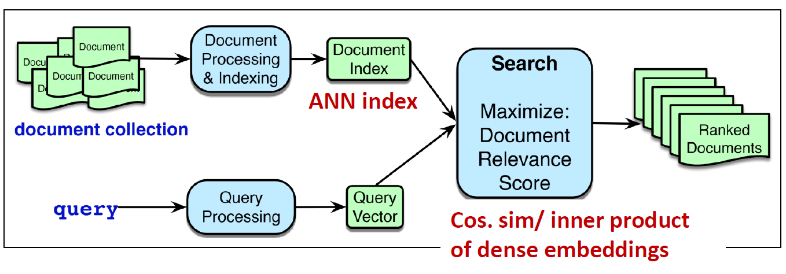
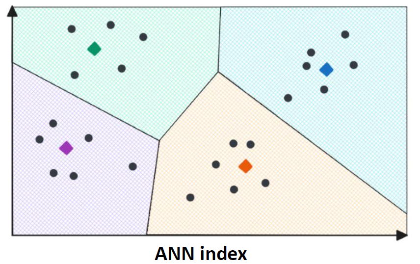
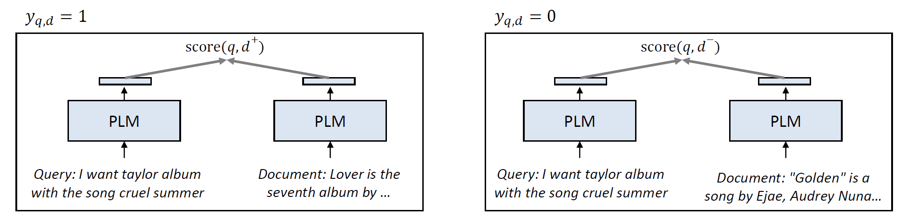
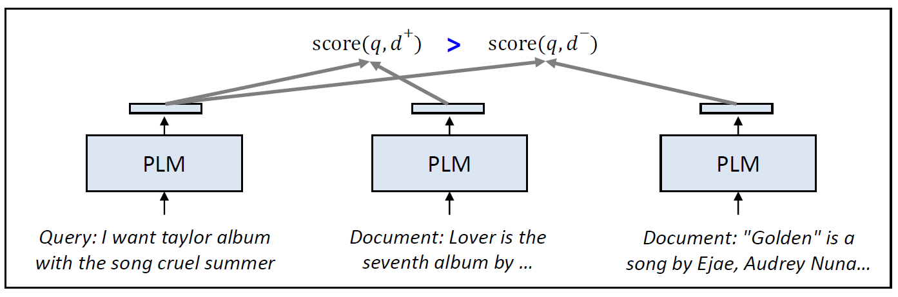
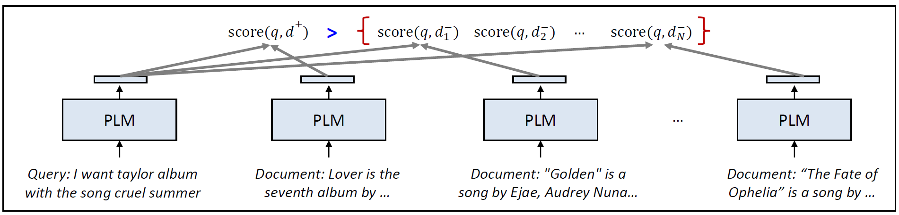

## Before starting

"Class" 카테고리에 있는 포스팅들은 실제로 수업에서 배운 내용을 정리하려는 목적으로 작성되었다. 이 글은 그 중 Text Mining 과목의 수업을 다룬다.

## Dense Retrieval

Dense Retrieval은 BERT 등의 Pretrianed model을 통해 Query와 Document를 Dense Embedding으로 변환하고, 이 상태로 그대로 검색에 활용하는 방법이다.

전체적인 구조는 [저번 글](https://blog.cloudholic.dev/posts/tm-8/)에서 다뤘던 Lexical Retrieval과 동일하지만, 세부적인 알고리즘 및 자료구조가 다르다.

### ANN Index

Dense Embedding이 완료된 상태면 Document Embedding의 집합을 얻게 된다. 이 상태에서 검색하기 위해 가장 간단하게 생각해볼 수 있는 방법은 Query Vector와 각각의 모든 Document Vector들에 대한 Inner Product를 계산하는 것이다. 

그런데 이 역시 Lexical Retrieval과 마찬가지로 연산량이 너무 많아진다는 문제가 있다. Lexical Retrieval에서 이 문제를 해결하기 위해 Inverted Index를 사용한 것과 비슷하게, Dense Retrieval에서는 ANN(Approximate Nearest Neighbor) Index를 사용한다.

ANN Index는 이름 그대로 가장 가까운 이웃들을 근사해서 찾아주는 Data Structure다. 

각각의 Document Vector는 Dense Context Vector이므로, 이들은 이미 의미적으로 유사한 것들끼리 모여있는 형태가 된다. 따라서 ANN Index에서는 이 벡터들을 Clustering하고 그렇게 형성된 각각의 Cluster마다 이를 대표하는 Centroid Vector를 만들어둔다.

이렇게 형성된 ANN Index에 Query Vector가 주어지면, 각각의 Centroid Vector와 Query Vector의 유사도를 계산한 후, 가장 유사도가 높은 Centroid Vector 및 거기에 속한 Cluster를 선택한다. 그리고 해당 Cluster의 Document Vector들을 Candidate로 삼아, 그 Cluster 내에서만 세부적으로 유사도를 계산하는 과정을 거친다.

사실 ANN Index는 이름에서도 "Approximate"라는 단어가 들어가듯이 Optimal함을 보장하는 것은 아니다. 그러나 훨씬 빠르고 또 많은 경우에선 합리적인 결과를 보여주기 때문에 널리 사용하는 방법이다.

## Learning to Rank

그러면 이제 유사도를 어떻게 계산할지 알아보자. Dense Retrieval에서는 Dense Contextual Vector를 다루기 때문에 이를 해결할 모델을 만들어야 한다. 즉, [Classification Task](https://blog.cloudholic.dev/posts/tm-4/#pretraining--fine-tuning)에서 다루었던 것과 유사하게 Search라는 Downstream Task를 해결하기 위해 Pretrained model을 fine-tuning 하는 식으로 학습시킨다.

이 Task에서 우리가 확보할 수 있는 Dataset은 관련 있는 Query와 Document의 Pair $\lbrace (q,d)\rbrace$이다. 그리고 Query가 주어질 때 좀 더 관련있는 Document가 상위에 랭크되도록 해야 한다. 그리고 이 Ranking은 각 Document 간의 상대적인 순서를 의미한다. 즉, Classification Task와 다르게, 독립적인 판단이 이루어질 수 없다.

이렇게 같은 패러다임을 공유한다는 점만 제외하고 Classification Task와는 결이 상당히 다른 Task임을 알 수 있다. 따라서 Loss 함수의 설계부터 다르게 접근해야 한다. 그리고 크게 Point-wise, Pair-wise, List-wise의 3가지 방식으로 나눌 수 있다.

### Point-wise

Point-wise Learning은 가장 간단하게, 하나의 Query-Document Pair가 서로 관련이 있는 Pair인지 아닌지만 맞춘다. 즉, Binary Classification Task의 Search 버전이라고 볼 수 있다.

그래서 Objective Function 역시 아래와 같이 간단하게 정의할 수 있다.

$$\hat{y}_{q,d}=p(\text{relevant}\vert q,d)=\sigma(\text{score}(q,d))\quad\quad\text{score}(q,d)=e_q^Te_d$$

그리고 이 때 Loss Function은 당연히 Binary Cross Entropy를 사용한다.

$$\mathcal{L}_{\text{point}}=-y_{q,d}\log\hat{y}_{q,d}-(1-y_{q,d})\log(1-\hat{y}_{q,d})$$

즉, $q$와 $d$가 관련이 있으면 $y_{q,d}=1$이고, 관련이 없으면 0이다.

이렇게 Point-wise Learning은 간단하고 직관적으로 Search Model을 학습시킬 수 있는 방법이지만, 사실 Ranking Task의 특수성을 잘 고려했다고 말하기는 어렵다. 위에서도 언급했던 "여러 Document 간의 상대적인 순서"를 전혀 고려하지 않기 떄문이다.

### Pair-wise

Pair-wise Learning은 여러 Document 간의 관계를 한 번에 고려하는 방향으로 확장된 형태이다. 즉, Query $q$가 주어졌을 때, 관련 있는 Document $d^{+}$가 관련 없는 Document $d^{-}$보다 더 높은 점수를 받도록 학습시킨다.

이를 위해 Objective Function은 다음과 같이 정의한다.

$$\sigma(\text{score}(q,d^{+})-\text{score}(q,d^{-}))=\dfrac{\exp(\text{score}(q,d^{+}))}{\exp(\text{score}(q,d^{+}))+\exp(\text{score}(q,d^{-}))}$$

즉, Document 2개를 동시에 보면서 학습시키며, 두 값의 점수 차이에 대해 Sigmoid를 취한다는 것을 확인할 수 있다. 이 점은 Positive Class와 Negative Class로 설정한 Classification Task와도 비슷하다고 할 수 있다. 

이 때의 Loss Function은 다음과 같다.

$$\mathcal{L}_{\text{pair}}=-\log\sigma(\text{score}(q,d^{+})-\text{score}(q,d^{-}))$$

늘 그렇듯 Negative Log를 취해서 이를 최소화시키는 형태로 정의된다. 즉, 두 점수 차이를 키우는 방향으로 학습이 진행된다.

그래서 사실 Pair-wise Learning도 Document 간의 절대적인 연관성을 학습시킨다기보다는, 2개의 Document가 있을 때 Negative Document보다 Positive Document를 더 선호하도록 하는 간접적인 방식을 취했다고 할 수 있다.

### Binary List-wise

Binary List-wise Learning에서는 한 번에 고려하는 Document의 수를 더 늘린다. 구체적으로, Positive Document 1개와 Negative Document $N$개를 상정하며, 당연히 이 모든 Negative Document보다 Positive Document가 더 높은 점수를 받도록 학습시킨다.

따라서 이 경우엔 다음과 같이 Softmax와 유사하게 생긴 Loss Function을 사용한다.

$$\mathcal{L}_{\text{list}}=-\log\dfrac{\exp(\text{score}(q,d^{+}))}{\exp(\text{score}(q,d^{+}))+\sum_{i=1}^{N}\exp(\text{score}(q,d_{i}^{-}))}$$

여담으로 이러한 형태의 Loss Function은 Contrastive Learning Loss라고도 부르며, 딥러닝 전 분야에서 널리 사용된다.

그런데 우리가 갖고 있는 Dataset은 $q$와 연관있는 $d$의 Pair일 뿐이다. 그러면 학습에 필요한 Negative Document를 어떻게 구할 수 있을까? 가장 간단하게는 갖고 있는 Corpus에서 Random sampling을 해볼 수 있다. 그런데 이러면 너무 비효율적이고 매번 Sampling을 다시 해야 한다는 문제가 생긴다.

따라서 In-batch Negative라는 방법을 사용한다. 즉, Batch 내에 있는 다른 Document들이 자연스럽게 다른 Query에 대한 Negative Document가 되도록 하는 것이다. 이를 통해 별도의 Sampling 없이도 Contrastive Learning Loss를 연산할 수 있게 된다.
